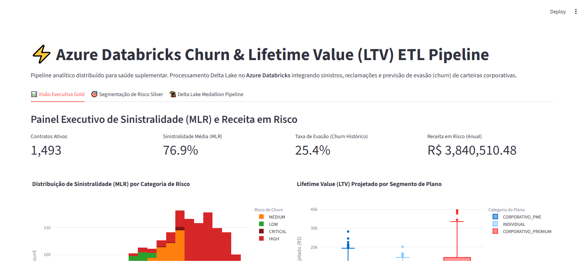

# ⚡ Azure Databricks Churn & Lifetime Value (LTV) ETL Pipeline

[](https://www.python.org/downloads/)
[](#)
[](#)
[](#)
[](#)
[](#)

Pipeline distribuído de Engenharia de Dados e Análise Preditiva de Churn para Saúde Suplementar no **Azure Databricks**, integrando sinistralidade ambulatorial/hospitalar (**Medical Loss Ratio - MLR**), reclamações (CSAT) e projeção de Lifetime Value (**LTV**).

---

## 📸 Validação Visual de Execução (Playwright E2E)

### Painel Executivo Gold (Sinistralidade, Churn e Receita em Risco)


---

## 🎯 Por que Azure Databricks na Gestão de Carteiras de Saúde?

Operadoras de planos de saúde enfrentam altas taxas de cancelamento corporativo decorrentes de sinistralidade descontrolada e reajustes contratuais.
Calcular métricas em tempo hábil para intervenção preventiva exige o processamento distribuído de milhões de guias médicas.

Este pipeline implementa:
1. **Delta Lake Medallion**: Ingestão contínua em Bronze, conformação de contratos e sinistros em Silver e agregação dimensional em Gold.
2. **Medical Loss Ratio (MLR)**: Monitoramento da proporção entre custos assistenciais e prêmio recebido ($\frac{\text{Claims Cost}}{\text{Annual Premium}}$).
3. **Fila de Retenção Ativa**: Identificação de clientes corporativos com risco crítico de evasão antes da janela anual de renovação contratual.

---

## 🏛️ Estrutura Arquitetural (CRISP-DM + SDD)

```
azure-databricks-churn-etl/
├── SPEC.md                           # Contratos Pydantic formais de entrada/saída
├── crisp_dm/
│   └── 01_business_understanding.md  # Fundamentação de negócio e MLR em saúde
├── src/
│   ├── schemas.py                    # Schemas Pydantic validados
│   ├── databricks_engine.py          # Motor distribuído ETL, LTV e Churn
│   └── app.py                        # Interface executiva (Streamlit)
├── tests/
│   └── unit/
│       └── test_databricks.py        # Testes de integridade analítica com PyTest
├── docs/
│   └── screenshots/                  # Evidências Playwright E2E
├── Dockerfile                        # Implantação em container
└── requirements.txt                  # Dependências fixadas
```

---

## 🧪 Métricas Chave de Negócio

| Métrica | Conceito / Fórmula | Alvo Operacional |
| :--- | :--- | :--- |
| **Medical Loss Ratio (MLR)** | $\frac{\text{Custo de Sinistros 12m}}{\text{Receita Anual de Prêmios}}$ | $\le 75\%$ (equilíbrio atuarial) |
| **Lifetime Value (LTV)** | $\text{Margem Líquida Anual} \times \ln(1 + \text{Tenure}) \times 0.85$ | Maximizar retenção rentável |
| **Churn Risk Score** | Modelo ponderado de MLR, chamados e tempo de carteira | Alerta imediato se $> 0.70$ |

---

## 🚀 Como Executar Localmente

### 1. Clonar o repositório
```bash
git clone https://github.com/generozo-paulo/azure-databricks-churn-etl.git
cd azure-databricks-churn-etl
```

### 2. Instalar dependências
```bash
pip install -r requirements.txt
```

### 3. Rodar suíte de testes unitários
```bash
python -m pytest tests/unit/ -v
```

### 4. Executar Dashboard Executivo
```bash
python -m streamlit run src/app.py
```
Acesse em: `http://localhost:8501`

---

## 🐳 Execução via Docker

```bash
docker build -t azure-databricks-churn-etl .
docker run -p 8501:8501 azure-databricks-churn-etl
```

---

## 👨‍💻 Autor

**Paulo Generozo**
- GitHub: [@generozo-paulo](https://github.com/generozo-paulo)
- Especialização: Big Data, Databricks & Analytics de Saúde Suplementar
